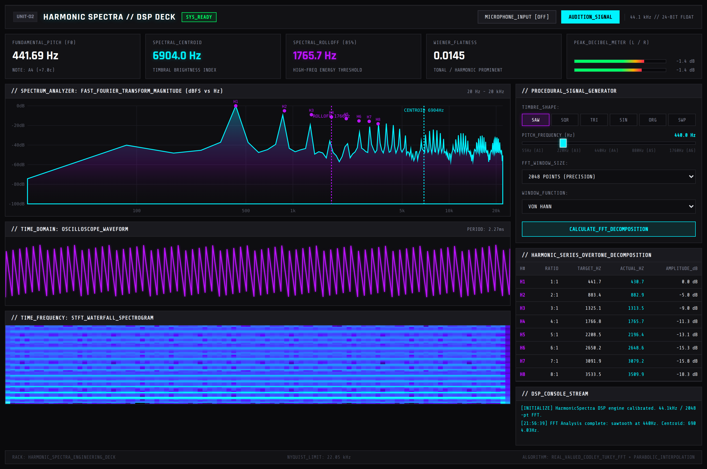
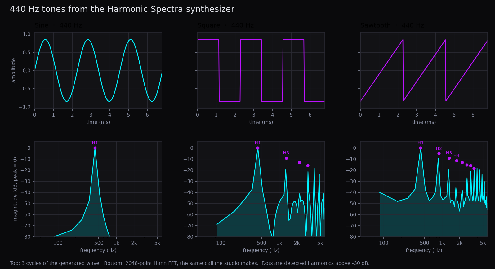
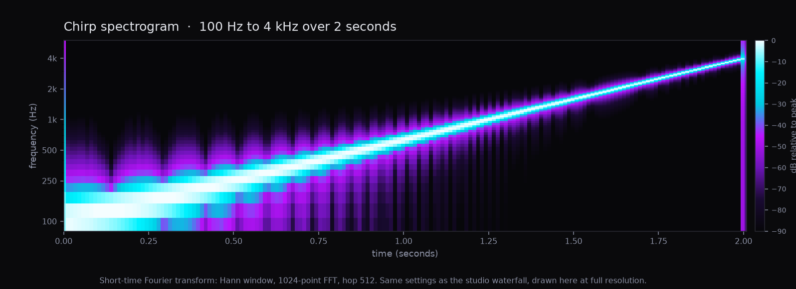

# Harmonic Spectra

[](https://www.python.org/)
[](https://fastapi.tiangolo.com/)
[](https://scipy.org/)
[](LICENSE)

A small browser studio that draws the frequencies inside a synthesized tone. A Python server builds the wave, runs a Fast Fourier Transform, and the page plots the spectrum, the harmonics, and a spectrogram.



The picture above is the running app, just after it loads. The tone is a **440 Hz sawtooth**, analyzed with a **2048-point Hann window** at **44.1 kHz**. Every number on the deck comes from that response.

On this run the pitch readout is **441.69 Hz (A4, +7 cents)**. That estimate is autocorrelation. The harmonic table is coarser: it reports the loudest FFT bin near each multiple of the pitch. At 2048 points those bins are about **21.5 Hz** apart, so the first harmonic shows up at **430.7 Hz** even though the pitch estimate is 441.69 Hz. Spectral centroid is the center of mass of the whole spectrum. A sawtooth spreads energy across many harmonics, so the centroid here is **6904 Hz**. The 85% rolloff is **1765.7 Hz**. Flatness is **0.0145**, and the page labels that as tonal.

The green bars rise to about **−1.4 dB** for a second after each analysis, then drop. Turn the microphone on and both bars follow that single input level, and the oscilloscope draws the live wave. Pitch, the spectrum, and the harmonic table stay on the last tone the server analyzed.

The corner of the header says "24-bit float." **AUDITION_SIGNAL** plays a 16-bit WAV.



A sine wave is one peak at the fundamental. A square wave is dominated by odd harmonics (1f, 3f, 5f, …), with smaller spikes between them left over from the window. A sawtooth keeps even and odd harmonics, so the spectrum stays busy as the frequency climbs. Dots mark harmonics the detector reported above −30 dB. These plots come from `src/synthesizer.py` and `src/dsp_engine.py`, using the same 2048-point Hann FFT the studio requests.



The **SWP** button glides from 100 Hz to 4 kHz. The picture is a 2 second glide from that same generator, using the studio's spectrogram settings: a Hann window, a 1024-point FFT, and a hop of 512 samples. The page draws a downsampled copy of that transform in the waterfall. A steady sawtooth barely changes over time, so the waterfall in the studio screenshot is a flat band. The sweep is where time shows up.

## Overview

Two notes can share a pitch and still sound different. A sine wave at 440 Hz is one pure tone. A sawtooth at 440 Hz is that same fundamental plus a stack of higher harmonics, which is why it sounds brighter. Harmonic Spectra exists to make that stack visible.

The page is a single audio deck. On load, and again whenever you change the wave, the pitch slider, the FFT size, or the window, the browser sends one request to a FastAPI server. The server synthesizes the samples, measures them, and returns JSON. The page then draws:

- a spectrum from about 20 Hz to 20 kHz
- an oscilloscope trace of the samples
- a time-frequency waterfall
- a table of the first harmonics
- pitch, spectral centroid, 85% rolloff, and spectral flatness

There is also a microphone button and an audition button. Those two stay in the browser. The analysis of pitch and harmonics always happens on the server, on a buffer the server just built or on a sample array you post yourself.

The useful part for reading the code is that the tone is defined in closed form. You know the input frequency before the FFT runs, so you can compare the readout with the slider. The screenshot at the top is that comparison for the default sawtooth: the slider says 440 Hz, autocorrelation says 441.69 Hz, and the harmonic table lands on FFT bins about 21.5 Hz wide.

## Features

### FFT spectrum

`DSPEngine.compute_fft` takes the first `n_fft` samples (2048 by default), multiplies them by a window, and calls `scipy.fft.rfft`. Magnitudes are scaled by `n_fft / 2`, converted to decibels, and shifted so the loudest bin is 0 dB. Values below −100 dB are clipped.

The array sent to the browser is stepped down to roughly 256 points so the JSON stays small. The canvas plots those points on a log frequency axis from 20 Hz to the Nyquist frequency, 22050 Hz, with grid lines at 100 Hz, 500 Hz, 1 kHz, 5 kHz, 10 kHz, and 20 kHz. Dashed markers show the centroid (cyan) and the 85% rolloff (violet) when they fall inside that range. Detected harmonics are drawn as dots labeled H1, H2, and so on.

The window choices in the UI are the ones `get_window` builds:

| UI label | Function |
| --- | --- |
| Von Hann | `numpy.hanning` |
| Hamming | `numpy.hamming` |
| Blackman | `numpy.blackman` |
| Rectangular | an array of ones |

Any other window name falls back to Hann. A window tapers the edges of the slice so a hard cut does not look like a click to the FFT. Rectangular leaves the slice untouched.

Three summary numbers are computed from the same magnitudes:

- **Spectral centroid** is the center of mass, `sum(f · |X|) / sum(|X|)`. On a bright sawtooth it sits far above the fundamental. In the screenshot it is 6904 Hz.
- **Spectral rolloff (85%)** walks the cumulative sum of magnitude-squared until 85% of that energy is included. In the screenshot that frequency is 1765.7 Hz. Rolloff weights energy, centroid weights magnitude, so the two numbers answer different questions and can be far apart.
- **Spectral flatness** is the geometric mean of the power spectrum divided by the arithmetic mean, clipped to the range 0–1. A single strong peak is near 0. A perfectly flat spectrum is 1. The page calls a value above 0.3 "NOISY / ATYPICAL" and anything else "TONAL / HARMONIC PROMINENT". The sawtooth in the screenshot is 0.0145, so it is labeled tonal.

### Pitch detection

Pitch is a separate estimate from the harmonic table. `detect_pitch_autocorrelation` subtracts the mean, rejects a near-silent buffer (standard deviation under `1e-5`), and computes a full autocorrelation with `numpy.correlate`.

It then searches lags that correspond to fundamentals between **40 Hz and 2400 Hz**. The strongest lag in that range is refined with a parabolic fit on the three surrounding correlation samples, and the frequency is `sample_rate / lag`. If that peak is less than a quarter of the zero-lag correlation, the function returns 0 and the page shows "INHARMONIC" and "NO PITCH LOCK".

The browser turns a positive frequency into a note name with equal temperament and A4 = 440 Hz: `12 * log2(freq / 440)`, rounded to the nearest MIDI note, with the remainder shown in cents. For 441.69 Hz that is A4, +7 cents, which is what the screenshot displays.

This tracker expects a fairly steady periodic tone. A chirp is a moving frequency, and the first FFT window is only the start of the glide, so the pitch box on **SWP** can settle somewhere other than the frequency you see in the spectrogram.

### Harmonic table

Once a fundamental `f0` exists, `extract_harmonics` looks for up to eight multiples. For harmonic `h` the target is `f0 * h`. The search window is the larger of 15 Hz and 5% of the target. The loudest FFT bin inside that window becomes `actual_hz`. Amplitude is reported in dB relative to the strongest magnitude in the spectrum. The ratio column is simply `h:1`.

The table therefore has two different frequency columns on purpose:

- **Target** is `h` times the autocorrelation pitch.
- **Actual** is an FFT bin center. Bin spacing is `sample_rate / n_fft`. At 44.1 kHz and 2048 points that is `44100 / 2048 ≈ 21.5 Hz`.

That is why the screenshot lists a target of 441.7 Hz and an actual of 430.7 Hz for H1. 430.7 Hz is the nearest analyzed bin, not a second pitch estimate. Choosing 4096 points cuts the spacing roughly in half. Harmonics whose target sits above Nyquist are dropped.

### Synthesizer

`AudioSynthesizer` builds mono float32 buffers at 44.1 kHz. The studio calls `generate_waveform`. After the shape is built, the buffer is scaled so its peak is 0.85.

| Button | Generator |
| --- | --- |
| SAW | `scipy.signal.sawtooth` at the slider frequency |
| SQR | `scipy.signal.square`. Odd harmonics dominate. |
| TRI | A triangle, implemented as a sawtooth with `width=0.5` |
| SIN | A single sine. Any unrecognized `wave_type` also takes this path. |
| ORG | Five sines added together, at 1×, 2×, 3×, 4×, and 8× the slider frequency, with weights 1.0, 0.8, 0.4, 0.5, and 0.3 |
| SWP | `scipy.signal.chirp` from 100 Hz to 4 kHz, logarithmic. The slider frequency is ignored. |

The slider in the page runs from 55 Hz to 1760 Hz. The API accepts 20 Hz to 10 kHz. The page always asks for **1.2 seconds**. The API default duration is 1.5 seconds, and it accepts 0.1 to 5 seconds.

`generate_harmonic_series` is a separate helper, used by the tests. It adds a weighted stack of sines (by default 1, 1/2, 1/4, … down to the 8th partial) and stops if a partial would reach Nyquist. There is no button for it on the deck.

`generate_sine` is the one-off sine used by the pitch test. It uses an amplitude of 0.8 and does not go through the 0.85 peak scale.

### Oscilloscope

For a synthesized tone, the server keeps at most 600 samples, stepped evenly through the whole buffer, rounded to 4 decimal places. The canvas draws that polyline in violet around a center line. The "PERIOD: 2.27ms" label in the panel header is fixed text in the HTML. It matches `1 / 440 Hz` and does not update when you move the slider.

While the microphone is on, the oscilloscope stops using those server samples and draws the live input instead.

### Waterfall

`compute_spectrogram` runs `scipy.signal.stft` on the **full** buffer, not only the first FFT window. The settings are fixed in the server: Hann window, 1024-point FFT, hop 512 (so the overlap is 512). Magnitudes become dB relative to the peak, clipped at −90 dB.

Before the matrix is sent, time and frequency axes are stepped down if they are long. The step is `length // 64`, and it stays 1 until an axis has at least 128 bins. A 1.2 second tone therefore keeps more than 64 time frames. The canvas paints low frequencies at the bottom, from black through violet to cyan.

The chirp image further up is the same transform drawn at full resolution for a 2 second glide, so the diagonal is easier to see than the in-app grid.

### Audition and meters

**AUDITION_SIGNAL** base64-decodes the WAV from the last analysis, turns it into an `AudioBuffer`, and plays it. Pressing the button again stops playback.

The two green bars are labeled L and R. The synthesizer is mono, and both bars show one level:

- After a server analysis, the page runs a short animation to a fixed factor of 0.85. `20 * log10(0.85)` is about **−1.4 dB**, which is the number in the screenshot. The right bar is drawn slightly shorter (96% of the left). About 1.2 seconds later both bars return to −inf. That bump is not a measurement of the samples.
- With the microphone on, both bars follow the peak absolute sample in the current input buffer. The level in dB is `20 * log10(peak)` when the peak is above 0.001, and "−inf dB" otherwise.

### Microphone path

**MICROPHONE_INPUT** calls `getUserMedia` for audio only. An `AnalyserNode` with `fftSize` 2048 reads float time-domain samples on each animation frame. That loop updates the oscilloscope and the two meters. It does not post audio to `/api/analyze-raw`, and it does not recompute pitch, centroid, harmonics, the spectrum, or the waterfall. Those panels keep showing the last tone the server analyzed. Denying permission writes an error line to the on-page console and leaves the mic off.

## How analysis works

This is the path behind **CALCULATE_FFT_DECOMPOSITION**, a timbre button, a slider release, and the automatic call on page load.

1. The browser sends `POST /api/analyze-synthetic` with `wave_type`, `frequency_hz`, `duration_sec` (always 1.2 from the page), `n_fft`, and `window_type`.
2. `AudioSynthesizer.generate_waveform` builds the float samples at 44.1 kHz.
3. `to_wav_bytes` clips those samples to [−1, 1], scales them to signed 16-bit integers, and writes a WAV with `scipy.io.wavfile`. The bytes are base64-encoded into `audio_base64_wav`.
4. `compute_fft` analyzes **only the first `n_fft` samples** of that buffer. At 2048 points and 44.1 kHz, that slice is about 46 milliseconds. The rest of the 1.2 seconds is not in the spectrum, the pitch estimate, or the harmonic table.
5. `compute_spectrogram` runs on the full buffer with the fixed 1024 / 512 STFT described above.
6. The oscilloscope list is the 600-point subsample of the full buffer.
7. The browser fills the readouts, the table, and the three canvases, and appends a line to the on-page log with the centroid.

`POST /api/analyze-raw` skips synthesis. You send your own samples, a sample rate from 8 kHz to 96 kHz, an FFT size, and a window. The response is only the FFT dictionary (pitch, centroid, rolloff, flatness, harmonics, and the downsampled spectrum). It does not include a spectrogram, an oscilloscope list, or a WAV. The studio UI never calls this route.

### Limits that matter when you read the deck

- **Harmonic frequencies snap to FFT bins.** Spacing is `44100 / n_fft`, about **21.5 Hz** at the default 2048-point window. The autocorrelation pitch can sit between bins. The table's "actual Hz" column cannot.
- **The spectrum and the pitch estimate see one short slice.** Only the first `n_fft` samples are analyzed. On a chirp, that slice is the start of the sweep, near 100 Hz. The waterfall is the view that covers the whole buffer.
- **Pitch search is 40 Hz to 2400 Hz.** A fundamental outside that range, or a correlation peak weaker than 0.25 of the zero-lag value, comes back as no pitch.
- **The microphone updates the oscilloscope and the meters in the browser.** The spectrum, harmonic table, centroid, rolloff, flatness, and pitch stay on the last server-analyzed tone.
- **The audition file is 16-bit PCM.** The header label that says "24-bit float" is text in the page, not the format of the WAV.
- **The meter bump after analysis is scripted** to about −1.4 dB for about a second. It is not a stereo measurement. The mic meters are a real peak of the mono input, copied to both bars.
- **The period label does not track the slider.** It stays "2.27ms".
- **The page footer names a Cooley–Tukey FFT.** The server calls `scipy.fft.rfft`. The parabolic interpolation in this project is the fractional-lag fit inside the autocorrelation, described above.

## API

The server is FastAPI, version string `1.0.0`. CORS is open to any origin. Interactive docs are the usual FastAPI pages at `/docs` once the app is running.

| Method | Path | What you send | What comes back |
| --- | --- | --- | --- |
| `GET` | `/` | nothing | `static/index.html` |
| `GET` | `/static/...` | nothing | CSS, the page script, and anything else in `static/` |
| `GET` | `/api/health` | nothing | `{"status": "HEALTHY", "system": "HarmonicSpectra", "version": "1.0.0"}` |
| `POST` | `/api/analyze-synthetic` | JSON body below | Waveform metadata, `fft_analysis`, `spectrogram`, `oscilloscope_samples`, `audio_base64_wav` |
| `POST` | `/api/analyze-raw` | JSON body below | The FFT dictionary only |

`POST /api/analyze-synthetic` body:

| Field | Default | Allowed | Role |
| --- | --- | --- | --- |
| `wave_type` | `sawtooth` | sine, sawtooth, square, triangle, organ, chirp (anything else becomes a sine) | Which generator to run |
| `frequency_hz` | `440` | 20 to 10000 | Slider pitch. Ignored by the chirp. |
| `duration_sec` | `1.5` | 0.1 to 5 | Length of the buffer. The page sends 1.2. |
| `n_fft` | `2048` | an integer; the model does not restrict the range | Length of the slice used for pitch, spectrum, and harmonics |
| `window_type` | `hann` | hann, hamming, blackman, rectangular | Analysis window. Unknown names become Hann. |

`fft_analysis` contains `sample_rate`, `n_fft`, `fundamental_frequency_hz`, `spectral_centroid_hz`, `spectral_rolloff_85_hz`, `spectral_flatness`, `harmonics`, and `spectrum`.

Each harmonic entry has `harmonic_number`, `target_hz`, `actual_hz`, `magnitude_linear`, `relative_amplitude_db`, and `harmonic_ratio`.

Each spectrum point has `freq_hz`, `magnitude_linear`, and `magnitude_db`.

`spectrogram` contains `time_bins`, `frequency_bins`, and `spectrogram_matrix_db`.

`POST /api/analyze-raw` body:

| Field | Default | Allowed | Role |
| --- | --- | --- | --- |
| `samples` | required | list of floats | The audio buffer, described as normalized samples in [−1, 1] |
| `sample_rate` | `44100` | 8000 to 96000 | Sample rate for this buffer |
| `n_fft` | `2048` | integer | FFT length |
| `window_type` | `hann` | same names as above | Analysis window |

A body that fails validation gets FastAPI's usual 422 response. If `static/index.html` is missing, `GET /` returns 404.

Example, from another terminal while the app is running:

```bash
curl -s http://127.0.0.1:8001/api/health

curl -s http://127.0.0.1:8001/api/analyze-synthetic \
  -H 'Content-Type: application/json' \
  -d '{"wave_type":"square","frequency_hz":440,"duration_sec":0.5,"n_fft":2048,"window_type":"hann"}'
```

The second call matches the payload in `tests/test_api.py`.

## Project structure

```
harmonic-spectra/
├── README.md
├── LICENSE
├── pyproject.toml          # package metadata, Python >= 3.9, runtime dependencies
├── requirements.txt        # runtime dependencies plus pytest and httpx
├── assets/
│   ├── studio-deck.png     # screenshot of the running studio
│   ├── waveform-spectra.png
│   └── chirp-spectrogram.png
├── src/
│   ├── __init__.py         # package version 1.0.0
│   ├── app.py              # FastAPI routes and static file serving
│   ├── dsp_engine.py       # FFT, pitch, harmonics, centroid, rolloff, flatness, STFT
│   └── synthesizer.py      # waveforms and 16-bit WAV encoding
├── static/
│   ├── index.html          # the deck markup
│   ├── app.js              # drawing, microphone, audition, API calls
│   └── style.css
└── tests/
    ├── test_api.py
    ├── test_dsp_engine.py
    └── test_synthesizer.py
```

`requirements.txt` also lists `httpx2` and `requests`. The current Python modules do not import them. FastAPI's `TestClient` does need `httpx`, which is why that package is there.

## Run it

Python 3.9 or newer. From a clone of this repository:

```bash
git clone https://github.com/lalitg13/harmonic-spectra.git
cd harmonic-spectra
python3 -m venv .venv
source .venv/bin/activate   # Windows: .venv\Scripts\activate
pip install -r requirements.txt
uvicorn src.app:app --host 127.0.0.1 --port 8001 --reload
```

Open [http://localhost:8001](http://localhost:8001).

The page requests an analysis immediately, so the deck fills in on its own. Change SAW, SQR, TRI, SIN, ORG, or SWP to hear a different shape. Drag the pitch slider and release it, or press **CALCULATE_FFT_DECOMPOSITION**, to run the request again. **AUDITION_SIGNAL** plays the 16-bit WAV from the last response. **MICROPHONE_INPUT** needs browser permission and only drives the oscilloscope and the meters.

Stop the server with Ctrl-C.

## Tests

From the same virtual environment, in the project folder:

```bash
pytest -v tests/
```

Seven tests, all hitting the modules above:

| Test | What it checks |
| --- | --- |
| `test_health_endpoint` | `GET /api/health` returns 200, status `HEALTHY`, system `HarmonicSpectra` |
| `test_analyze_synthetic_endpoint` | A 440 Hz square wave, 0.5 s, 2048-point Hann, returns `fft_analysis`, `spectrogram`, `oscilloscope_samples`, and `audio_base64_wav` |
| `test_fft_frequency_peak_accuracy` | A 1 second 440 Hz sine, 4096-point FFT: pitch within 5 Hz of 440, centroid within 25 Hz |
| `test_harmonic_series_extraction` | `generate_harmonic_series` at 200 Hz yields at least four harmonics, and H1's actual frequency is within 15 Hz of 200 |
| `test_spectral_flatness_bounds` | A flat magnitude spectrum is about 1. A single spike is under 0.1 |
| `test_generate_waveforms` | All six UI wave types at 300 Hz for 0.5 s have the right length and a peak of at most 1 |
| `test_to_wav_bytes` | A short sine encodes to bytes that start with `RIFF` and are longer than a 44-byte header |

## License

MIT. Copyright (c) 2026 Lalit Chandra Gudla. See [LICENSE](LICENSE).
